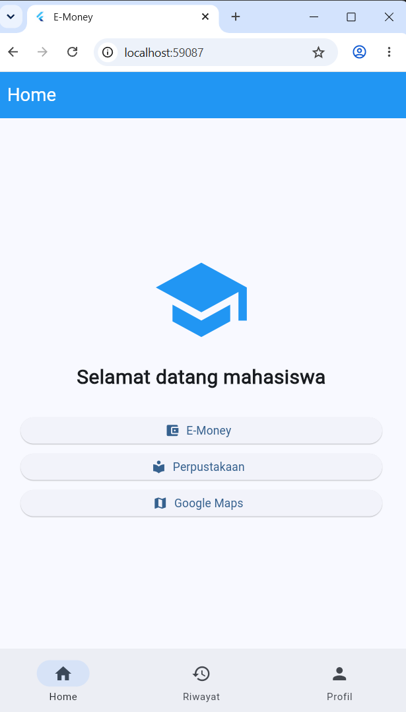
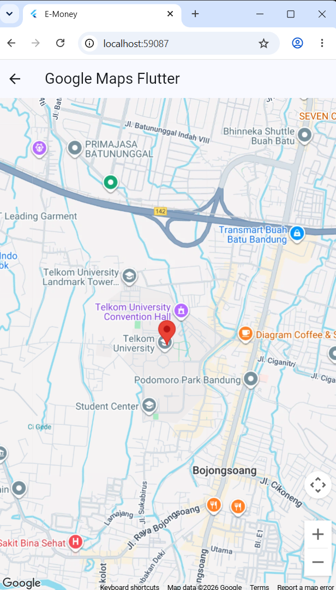
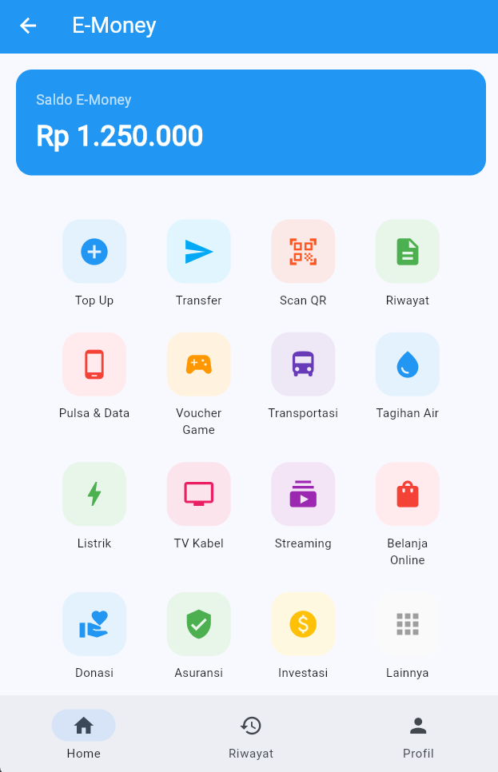
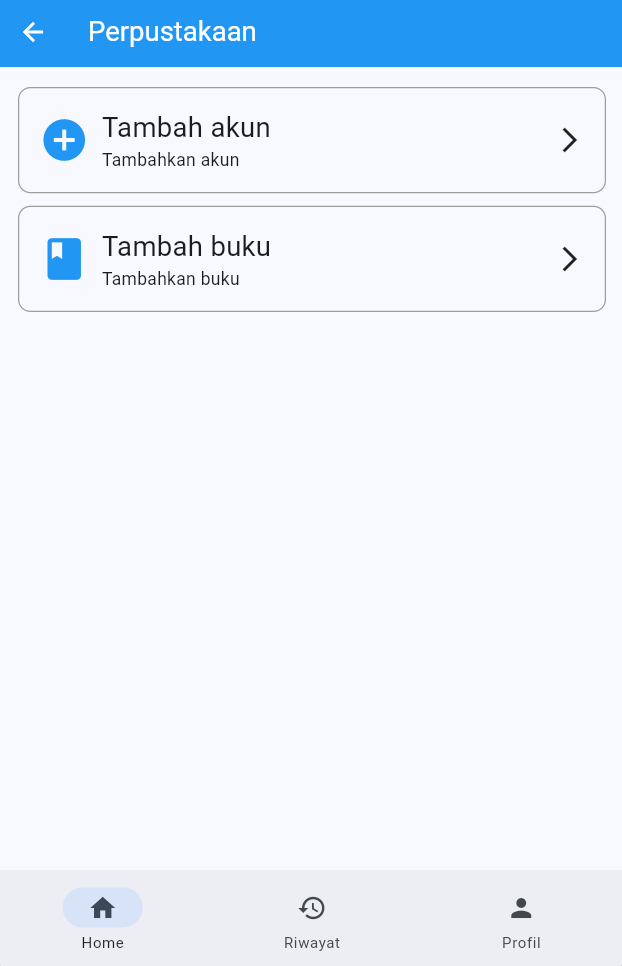
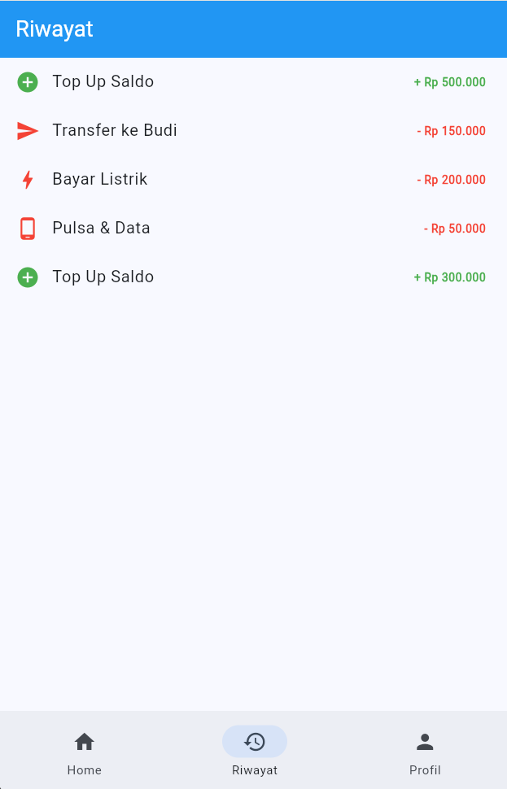
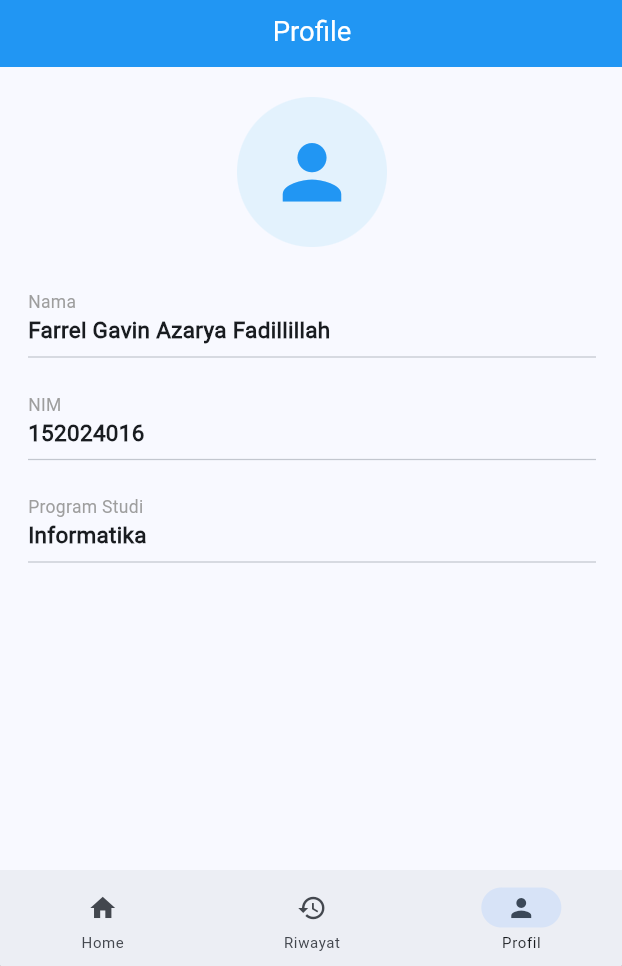

# 📱 E-Money App — Flutter + Google Maps

Aplikasi mobile sederhana berbasis **Flutter** yang menampilkan beranda mahasiswa, E-Money, Perpustakaan, Riwayat, Profil, dan **fitur terbaru: Google Maps** yang menampilkan lokasi kampus lengkap dengan marker dan info window.

> **Tugas 5 — Pemrograman Mobile: Implementasi Google Maps pada Flutter**
>
> | | |
> |---|---|
> | **Nama** | Farrel Gavin |
> | **NPM** | 152024016 |
> | **Mata Kuliah** | Pemrograman Mobile |

---

## ✨ Fitur Aplikasi

| Fitur | Deskripsi |
|---|---|
| 🏠 **Home** | Sambutan "Selamat datang mahasiswa" dan tombol navigasi ke E-Money, Perpustakaan, dan Google Maps. |
| 💳 **E-Money** | Menampilkan saldo E-Money. |
| 📚 **Perpustakaan** | Menu *Tambah akun* dan *Tambah buku*. |
| 🧾 **Riwayat** | Daftar riwayat transaksi. |
| 👤 **Profil** | Informasi profil pengguna. |
| 🧭 **Navbar** | Bottom navigation (Home, Riwayat, Profil) yang dipakai di tiap halaman. |
| 🗺️ **Google Maps** *(baru)* | Peta interaktif dengan marker lokasi kampus. |

### 🗺️ Detail Fitur Google Maps (Baru)

Halaman peta ada di `lib/pages/halaman_maps.dart` (class `HalamanMaps`) dan dibuka lewat tombol **Google Maps** di halaman Home.

- Menggunakan widget `GoogleMap` dari package [`google_maps_flutter`](https://pub.dev/packages/google_maps_flutter).
- **Posisi awal kamera** diarahkan ke lokasi kampus dengan zoom `15`.
- **Marker** ditampilkan pada koordinat kampus dengan `InfoWindow`:
  - Judul: `Telkom University`
  - Snippet: `Jl. Telekomunikasi Bandung`
- Koordinat (`LatLng`): `-6.9730070, 107.6305286`
- Mendukung gestur bawaan Google Maps (geser, zoom, rotasi).
- Berjalan di **Android** dan **Web (Chrome)**.

Potongan kode inti:

```dart
GoogleMap(
  initialCameraPosition: const CameraPosition(
    target: LatLng(-6.9730070, 107.6305286),
    zoom: 15,
  ),
  markers: _marker,
)
```

---

## 🛠️ Teknologi & Tools

- **Framework:** Flutter (Dart, SDK `^3.13.4`)
- **UI:** Material 3
- **Package:** `google_maps_flutter ^2.19.0`, `cupertino_icons ^1.0.8`
- **API Service:** Google Cloud Console — *Maps SDK for Android* & *Maps JavaScript API*
- **IDE:** Visual Studio Code / Android Studio

---

## 📂 Struktur Folder

```text
lib/
├── main.dart                    # Entry point (EMoneyApp)
├── pages/
│   ├── home_page.dart           # Beranda + tombol navigasi (termasuk Maps)
│   ├── halaman_maps.dart        # 🗺️ Halaman Google Maps (Tugas 5)
│   ├── emoney_page.dart
│   ├── perpustakaan_page.dart
│   ├── riwayat_page.dart
│   ├── profil_page.dart
│   ├── halaman_menu.dart        # Grid menu (Top Up, Transfer, Scan QR, dll.)
│   └── halaman_tujuan.dart      # Halaman tujuan dari grid menu
└── widgets/
    └── navbar.dart              # Bottom navigation reusable
screenshots/                     # Tangkapan layar aplikasi
```

---

## 🔑 Konfigurasi Google Maps API Key

Agar peta tampil, kamu membutuhkan API key dari [Google Cloud Console](https://console.cloud.google.com/):

1. Buat project, lalu aktifkan **Maps SDK for Android** dan **Maps JavaScript API**.
2. Buat API key di menu *APIs & Services → Credentials*.
3. Pasang key di dua tempat berikut:

**Android** — `android/app/src/main/AndroidManifest.xml`

```xml
<meta-data
    android:name="com.google.android.geo.API_KEY"
    android:value="YOUR_API_KEY_HERE" />
```

**Web** — `web/index.html`

```html
<script src="https://maps.googleapis.com/maps/api/js?key=YOUR_API_KEY_HERE"></script>
```

> ⚠️ **Jangan commit API key asli ke repository publik.** Batasi key (Application restrictions & API restrictions) di Google Cloud Console, dan jangan push file `api_key.txt` — tambahkan ke `.gitignore`. Jika key sudah terlanjur ter-push, sebaiknya *regenerate* key tersebut.

---

## 🚀 Cara Menjalankan

**Prasyarat:** [Flutter SDK](https://docs.flutter.dev/get-started/install) terpasang dan API key sudah dikonfigurasi.

```bash
# 1. Clone repository
git clone https://github.com/farrelgavin/Tugas-Maps-Flutter-pemrogramman-mobile-.git

# 2. Masuk ke direktori project
cd Tugas-Maps-Flutter-pemrogramman-mobile-

# 3. Unduh dependencies
flutter pub get
```

Jalankan aplikasi:

```bash
# Di browser (Chrome)
flutter run -d chrome

# Di emulator / perangkat Android
flutter run
```

---

## 🖼️ Screenshot

### Halaman Home & Google Maps (Baru)

| Home (tombol Google Maps) | Google Maps (marker kampus) |
|:---:|:---:|
|  |  |

### Halaman Lainnya

| E-Money | Perpustakaan |
|:---:|:---:|
|  |  |

| Riwayat | Profil |
|:---:|:---:|
|  |  |

---

## 📜 Riwayat Pengembangan

1. **Tugas 4** — Menambahkan Navbar.
2. Menambahkan README dan screenshot.
3. **Tugas 5** — Menambahkan fitur Google Maps.
